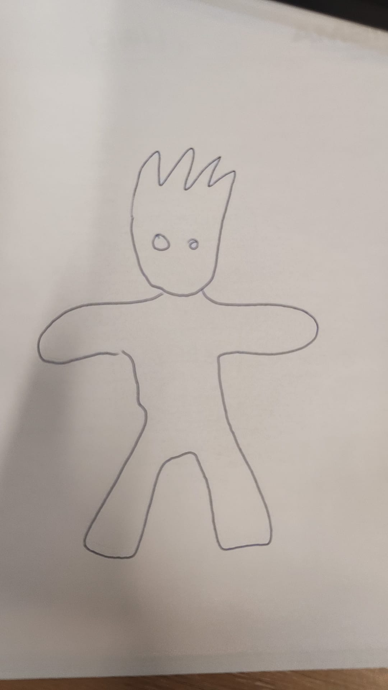
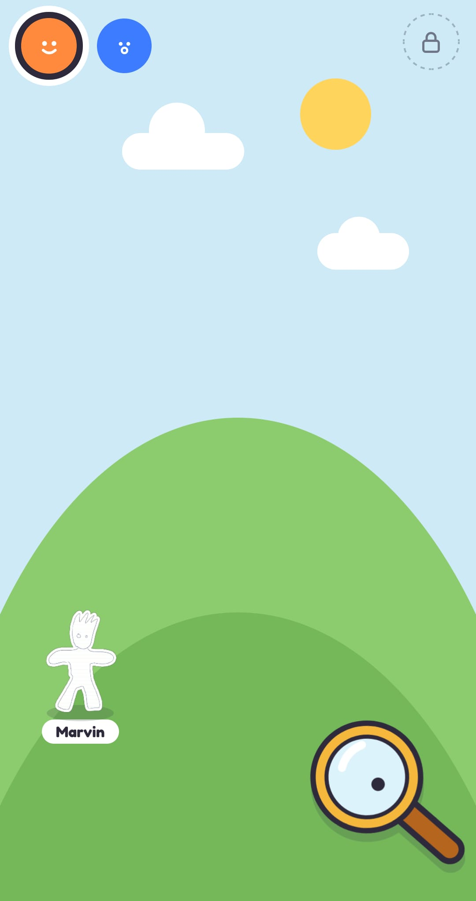
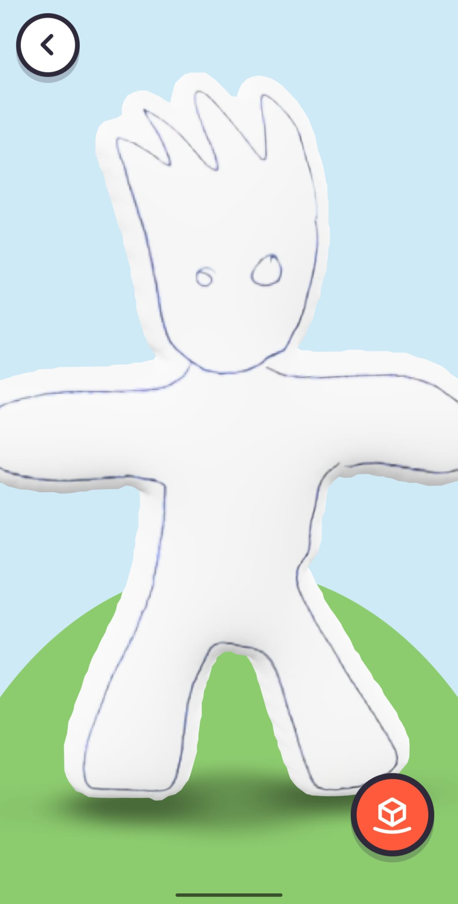
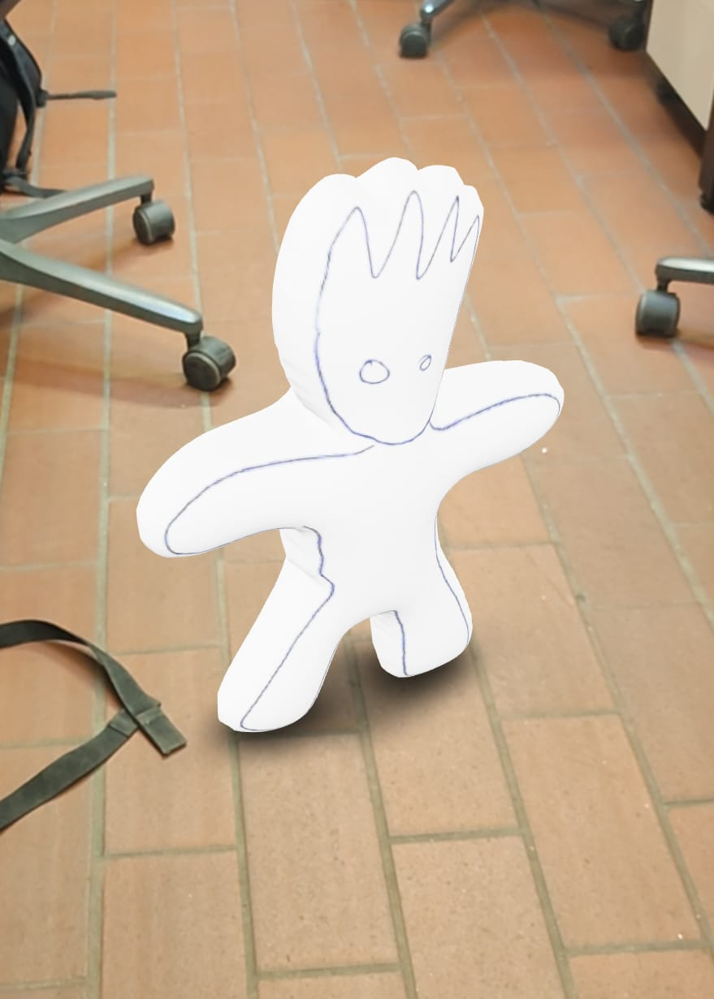
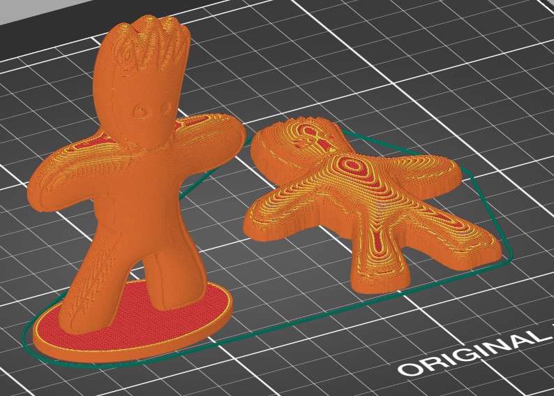

# Monster Maker

Kids draw monsters on paper; a parent photographs them with the tablet; the home server cuts them out and they come alive on screen, puff up in 3D, step into the room in AR and come out of the 3D printer. Fully self-hosted.

<p align="center">
  
  
  
  
</p>
<p align="center"><em>The photo of the drawing · on the hill · the faithful 3D balloon · in the room with AR</em></p>

- `CLAUDE.md` — project context for Claude Code (read automatically each session)
- `docs/plan.md` — full plan: architecture, pipeline, data model, phases, risks
- `docs/kids-ui.md` — the chosen kids UI ("Monster Hill")
- `prototype/` — working single-page UI prototype

## How the machines fit together

```
dev machine A ─┐
dev machine B ─┼─ git push ──► central repo ──► CI builds images ──► registry
dev machine C ─┘                                                      │
                                         docker compose pull ◄────────┤
                                         home server (compose.yaml)   │
                                                                      │
                                         docker compose pull ◄────────┘
                                         gaming PC (compose.gpu.yaml, Phase 2+)
```

- **Develop:** clone the repo on any dev machine, run `claude` in it. `CLAUDE.md` comes along with the repo, so every machine gets the same context. Pull before you start, push when you stop.
- **Deploy:** on the home server, `docker compose pull && docker compose up -d`. To roll back, set the image tag to an earlier git sha.
- **Data:** kids' drawings and the database stay on the home server only. They are never committed or put into images.

## Layout

- `server/` — Python package `monster`: FastAPI app (`api.py`), SQLite job queue with leases (`jobs.py`), CPU worker (`worker.py`), pipeline steps (`steps/`). One image runs both the API and the worker.
- `frontend/` — tablet PWA, SvelteKit (static SPA, pnpm). Screens: `Hill`, `Lens` (camera), `Wake` (sleep → wake, eyes, name), `Puff` (3D + AR); renderer in `src/lib/critter.ts`.
- `gpu/` — Python package `monster_gpu`: the GPU worker for the gaming PC (pull loop `worker.py`, game/hours check `gate.py`, TRELLIS.2 step `trellis.py`, a model-free `placeholder.py`) and its CUDA image (`Dockerfile`).
- `web/` — Caddy config and image (serves the built frontend over HTTP, proxies `/api`); the host's nginx terminates TLS in front of it. `Caddyfile.dev` proxies to the Vite dev server instead.
- `compose.yaml` (home server, images only) · `compose.gpu.yaml` (gaming PC) · `compose.dev.yaml` (dev, build + hot reload) · `.env.example` · `deploy/nginx/monster.conf` (home server vhost).

## Dev quick start

```
cd server && uv sync && uv run pytest            # backend tests (includes the GPU round trip)
cd gpu && uv sync && uv run pytest               # GPU worker tests (no GPU needed)
cd frontend && pnpm install && pnpm check        # frontend type check
docker compose -f compose.dev.yaml up --build    # full stack with hot reload at http://localhost:8099
```

Without Docker, three terminals: in `server/`, `MONSTER_DATA_DIR=../data uv run uvicorn monster.api:app --reload` and `MONSTER_DATA_DIR=../data uv run python -m monster.worker`; in `frontend/`, `pnpm dev` (proxies `/api` to port 8000). The live camera needs HTTPS (or localhost, which browsers treat as a secure context); otherwise the red button falls back to the tablet's camera app.

## AR support

The AR button on the 3D screen only appears when `<model-viewer>` finds a way into AR on the device; otherwise the monster still spins in 3D.

| Device | AR route | Notes |
| --- | --- | --- |
| iPhone / iPad, Safari | Apple AR Quick Look (model converted to USDZ in the browser) | Not when the app is opened from a home-screen icon: iOS disables Quick Look there, so open it in Safari itself. Other iOS browsers may not offer it. |
| Android, Chrome or Samsung Internet | Google Scene Viewer, or WebXR in Chrome | Needs Google Play Services for AR (ARCore), which [not every phone supports](https://developers.google.com/ar/devices). Scene Viewer is a Google app on the device that downloads the model straight from the home server; to keep AR inside the browser only, drop `scene-viewer` from `ar-modes` in `Puff.svelte` (fewer phones will then offer AR). |
| Android Firefox, desktop browsers | none | 3D only. |

The model is about 20 cm tall in AR and stands on the floor or table it is placed on.

## 3D printing

Every monster also gets a `print.3mf` (parent mode → the dark printer button on the monster). It holds two versions side by side; delete the one you don't want in the slicer:

- **standing** — the whole balloon, 8 cm tall, feet sunk into an oval plinth. The arms usually need supports.
- **lying** — the front half on a 1.6 mm base plate, printed on its back. No supports, sturdiest for small hands.

<p align="center">
  
</p>

Tuned for a single-colour FDM printer with a 0.4 mm nozzle (Prusa MK3S+ with PrusaSlicer): the drawing's pen lines are engraved 0.6 mm deep and widened to about 1 mm so the nozzle can draw them. Sizes and depths are constants at the top of `server/monster/steps/print_prep.py`.

## AI 3D (GPU worker on the gaming PC)

Beside the faithful balloon, the gaming PC makes an AI version with [TRELLIS.2](https://github.com/microsoft/TRELLIS.2) (MIT). On the 3D screen it spins in a bubble in the corner; tapping the bubble swaps the two, and the one in front is the kid's pick. A sparkle on the hill's 3D badge means the AI version is there. Parent mode shows whether the PC is ready, gaming or off, and how many monsters wait for it.

The worker runs only while you have it open in a terminal. It only pulls: every 30 s it checks it is free (no Steam/Proton game running, less than 2 GB VRAM in use by others, inside `MONSTER_GPU_HOURS`), asks the server for a job, runs it in a fresh process and uploads the GLB. A game starting mid-job stops it and hands it back. With the PC off, jobs wait as `waiting_for_gpu` and the tablet doesn't care.

Setup, once:

1. Home server: put a `MONSTER_WORKER_TOKEN` (`openssl rand -hex 32`) in `.env`, `docker compose up -d`. Until then the GPU endpoints are off.
2. Gaming PC: NVIDIA driver plus the [NVIDIA Container Toolkit](https://docs.nvidia.com/datacenter/cloud-native/container-toolkit/latest/install-guide.html) (Arch: `sudo pacman -S --needed nvidia-container-toolkit && sudo nvidia-ctk runtime configure --runtime=docker && sudo systemctl restart docker`). Check with `docker run --rm --gpus all nvidia/cuda:12.4.1-base-ubuntu22.04 nvidia-smi`.
3. Gaming PC: a directory with `compose.gpu.yaml` and a `.env` (gaming PC section of `.env.example`: `REGISTRY`, `MONSTER_SERVER`, the same `MONSTER_WORKER_TOKEN`, `HF_TOKEN`). Create `CACHE_DIR` owned by `PUID` first. `docker login ghcr.io` as on the server.
4. Hugging Face: TRELLIS.2 needs Meta's DINOv3 image encoder, which is gated: accept its licence on its [model page](https://huggingface.co/facebook/dinov3-vitl16-pretrain-lvd1689m) and put a read token in `HF_TOKEN`. The weights (~16 GB) download once into `CACHE_DIR`; drawings never leave the house.
5. Run it by hand, in the foreground: `docker compose -f compose.gpu.yaml pull && docker compose -f compose.gpu.yaml up`. It never runs unattended: no `-d`, no restart policy, nothing at boot. Ctrl+C stops it and hands a running job back; jobs then wait until the next time you start it.

Test in two steps: first with `MONSTER_GPU_PLACEHOLDER=1` (no model: the drawing on a flat card) to check the round trip, then without it. The image is built by `.github/workflows/gpu.yml` when `gpu/` changes on `main`, or by hand from the Actions tab.

### Trying it from a clone on the gaming PC

Before anything is deployed, the whole stack can run from source on the PC itself (NVIDIA driver and Container Toolkit as in step 2 above):

```
git clone git@github.com:<user>/monster-maker.git && cd monster-maker && git switch phase2-gpu-trellis
mkdir -p data cache                      # owned by you, before Docker creates them as root
echo "HF_TOKEN=hf_..." > .env            # after accepting the DINOv3 licence
docker compose -f compose.dev.yaml --profile gpu up --build
```

The first build compiles the CUDA extensions (~30–60 min). Then open http://localhost:8099, unlock parent mode (hold the lock) and use "Add from photos" with `tests/fixtures/*.jpeg`. The first AI job also downloads ~16 GB of weights into `cache/`. Follow it with `docker compose -f compose.dev.yaml logs -f gpu-worker`; the sparkle appears on the 3D badge when it is done.

- Plumbing only, no model: add `MONSTER_GPU_PLACEHOLDER=1` to `.env`.
- TRELLIS alone on one picture, with timing and peak VRAM: `docker compose -f compose.dev.yaml --profile gpu run --rm gpu-worker python -m monster_gpu.try_step ai3d /data/creatures/1/creature.png /data/try` (the result is `data/try/ai.glb`; drop it on https://gltf-viewer.donmccurdy.com or open it in Blender).
- Game check: start a Steam game while a job runs; the log shows it being handed back.

Tuning (gaming PC `.env`): `MONSTER_TRELLIS_PIPELINE` (`1024_cascade` by default; out of memory falls back to `512`), `MONSTER_AI_FACES`, `MONSTER_AI_TEXTURE`, and `MONSTER_AI_YAW_DEG` if the AI monster faces away from the camera.

## Deploy

CI (`.github/workflows/build.yml`) tests and builds `monster-maker-api` and `monster-maker-web` on every push to `main` and pushes them to GHCR. The home server keeps no checkout: it has a directory (`~/dockerfiles/monster-maker/`) holding `compose.yaml`, `.env` and `data/`, and updates with `docker compose pull && docker compose up -d`. Set `REGISTRY=ghcr.io/<user>` in `.env` and `docker login ghcr.io` once with a classic PAT scoped `read:packages`. When `compose.yaml` changes in the repo, copy it over again — `pull` only updates images.

Containers run unprivileged as `PUID`/`PGID` (default 1000), which must own `DATA_DIR`, so `creatures/` and the SQLite file stay readable and backup-able without sudo. Create `DATA_DIR` before the first start: a bind-mount target that Docker has to create itself lands as root, and the containers then cannot write to it.

The home server already runs nginx on 80/443 for the other household services, so the web container listens on `127.0.0.1:8095` (`WEB_HOST_BIND`/`WEB_HOST_PORT`) and nginx terminates TLS in front of it. Install `deploy/nginx/monster.conf` once — it is a template for `monster.example.com` (the header shows how to install it under your own name) with a Let's Encrypt certificate (so nothing to install on the tablet) and restricts access to the LAN, since the app has no login of its own. Setup steps are in the file's header.

First prompt suggestion: "Read CLAUDE.md and the prototype, then propose a plan for Milestone 1." Use plan mode for the first pass.
